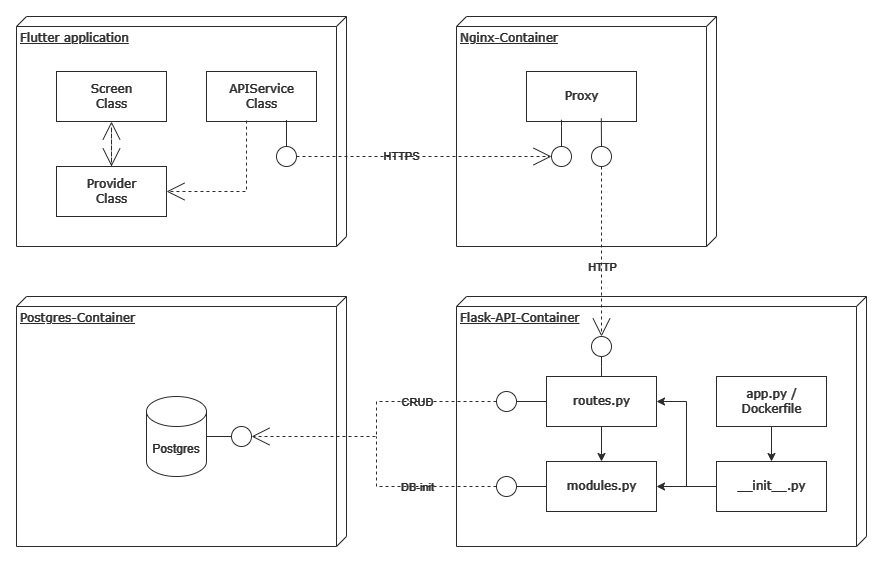
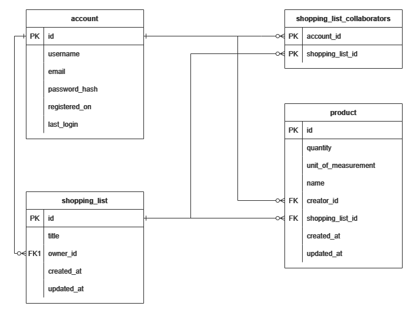

# ShoppyList API

A Flask REST API with PostgreSQL and JWT authentication: the backend of the ShoppyList shopping-list app.



## What and why

ShoppyList was a school project (apprenticeship, 2024): a shopping-list app whose lists can be shared with other users. The Flutter client is in [shoppyList_mobileApplication](https://github.com/daniel-bernet/shoppyList_mobileApplication). This repository is the API it talks to.

The app started out on Firebase. After the first week I replaced Firebase with this API and my own PostgreSQL database. During the project, the API and the database ran as Docker containers on my Unraid server at home, behind an NGINX reverse proxy that handled HTTPS. It is no longer deployed.

What the API does:

- **Accounts:** register, log in, refresh the access token, change password, username or email, delete the account (with its lists and products).
- **Lists:** create, delete, list the ones you own or collaborate on, add or remove collaborators, leave a list.
- **Products:** add, edit, delete (one or several at once), with quantity and unit.

Passwords are stored as Werkzeug hashes. Requests are authenticated with JWT access tokens (30 minutes) and refresh tokens.

## Result

The API did what the app needed for the project. In 2026 I checked it again from a clean clone: the app's main screens work against it with test data. During the project one family member tried the app for a week, then went back to pen and paper.

Looking at it again in 2026, it has real flaws, listed under [Limitations](#limitations-and-status). I left them unfixed on purpose: the repository shows the project as it was.

## How to run

You need Docker with Compose.

```bash
cp .env.example .env    # then replace the placeholder values
docker compose up --build
```

The API listens on `http://localhost:5000`. The tables are created on first start. A quick check:

```bash
curl -X POST http://localhost:5000/register -H 'Content-Type: application/json' \
  -d '{"username":"demo","email":"demo@example.com","password":"Demo-Pass1!"}'
```

Without Docker: Python 3.11 or 3.12, a PostgreSQL database, `pip install -r requirements.txt`, set `DATABASE_URL`, `SECRET_KEY` and `JWT_SECRET_KEY`, then `flask run`.

## Endpoints

| Method | Path | Purpose |
|---|---|---|
| POST | `/register`, `/login` | Create an account or log in; returns access and refresh tokens |
| POST | `/token/refresh` | New access token from a refresh token |
| GET | `/validate-token`, `/account` | Check the token, get account details |
| POST | `/change_password`, `/edit_username`, `/edit_email` | Change account details (current password required) |
| DELETE | `/delete_account` | Delete the account and its data |
| GET, POST | `/shopping_lists` | Your lists (owned and shared), create a list |
| DELETE | `/shopping_lists/<id>` | Delete a list |
| POST | `/shopping_lists/<id>/collaborators` | Add a collaborator by email |
| DELETE | `/shopping_lists/<id>/collaborators/<username>` | Remove a collaborator and their products |
| POST | `/shopping_lists/<id>/leave` | Leave a shared list |
| GET, POST | `/shopping_lists/<id>/products` | List or add products |
| PUT, DELETE | `/shopping_lists/<id>/products/<product_id>` | Edit or delete a product |
| POST | `/shopping_lists/<id>/products/batch_delete` | Delete several products |

## Data model



Four tables: `account`, `shopping_list`, `product` and the join table `shopping_list_collaborators`. All keys are UUIDs. The models are in `app/models.py` (the component diagram calls it `modules.py`).

## Limitations and status

Completed in March 2024 and not maintained. The tag `v1.0` marks the state as submitted. The commits after it only make the project run from a clean clone (configuration through environment variables, `docker-compose.yml`, a cleaned-up `requirements.txt`, `.gitignore`) and update the documentation.

Known problems, not fixed:

- **Rate limiting is never active.** `app/routes.py` creates a second `Limiter` that is never attached to the app, so the limits on login and registration have no effect.
- **Timestamps are frozen.** The column defaults call `datetime.now()` once, when the module is imported, so new rows get the server's start time instead of the current time. `updated_at` has the same problem wherever a route doesn't set it explicitly.
- **Collaborators can delete the owner's list.** The delete endpoint allows the owner and every collaborator.
- **Development server in the Docker image.** The container runs `flask run`, not a production WSGI server.
- **No tests.**
- No database migrations; the tables are created with `db.create_all()` at startup.
- The dependencies are the versions pinned in March 2024.

## Licence

The code is under the [MIT licence](LICENSE). The documentation and diagrams are under [CC BY 4.0](https://creativecommons.org/licenses/by/4.0/).

## Credits

The dependencies in `requirements.txt` (Flask, SQLAlchemy, Flask-JWT-Extended, Flask-Limiter, psycopg2 and others) are installed from PyPI and keep their own licences.

More about my projects: [dbernet.ch/projects](https://dbernet.ch/projects/)
